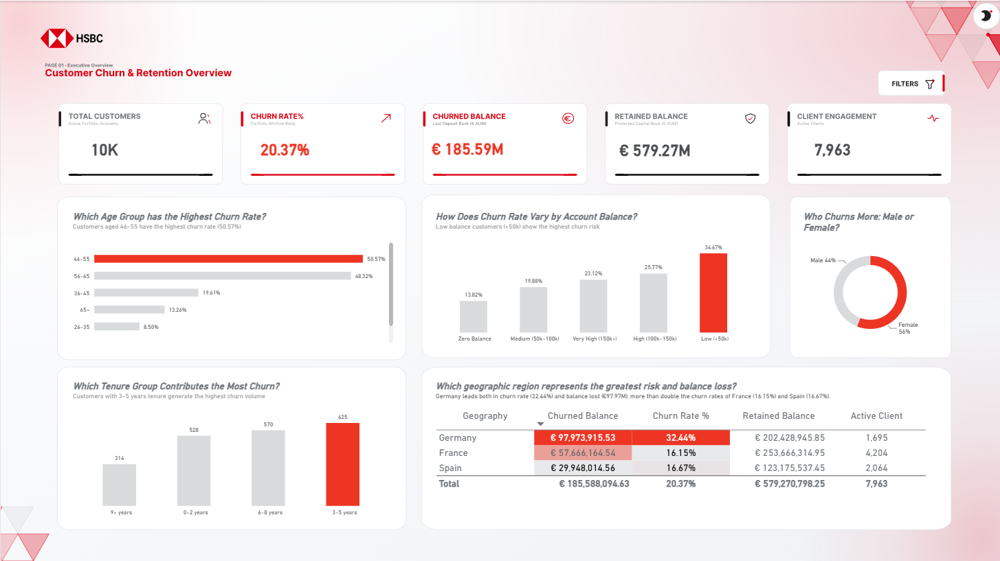

# Bank Customer Churn & Retention Dashboard


[Live Portfolio ↗](https://nady-07.github.io/portfolio/#portfolio) · [Download .PBIX File](./Bank_Churn_Project.pbix) · [LinkedIn](https://www.linkedin.com/in/mohamed-alnady-52b87123b)

A Power BI executive dashboard that shows **which bank customers leave, how much deposit balance leaves with them, and where retention efforts should focus**. It is styled with an HSBC-inspired look and available in light and dark themes.

> **Disclaimer:** This is a portfolio project built on a sample customer dataset of 10,000 records. It does not use real bank data and is not affiliated with HSBC.



## Contents

- [Project goal](#project-goal)
- [Dashboard pages](#dashboard-pages)
- [Headline KPIs](#headline-kpis)
- [Key findings](#key-findings)
- [Recommendations](#recommendations)
- [Data model](#data-model)
- [Getting started](#getting-started)
- [Repository structure](#repository-structure)

## Project goal

For a bank, churn costs more than customer numbers: every departing customer takes a deposit balance with them. This dashboard measures churn in both **customers** and **balance (€)** to answer:

1. **Who** is leaving, by age, gender, balance level and tenure?
2. **Where** is the risk concentrated geographically?
3. **How much** deposit balance is lost versus retained?

Each chart is titled as a business question with a one-line answer beneath it.

## Dashboard pages

| # | Page | What it covers |
|---|------|----------------|
| 1 | **Executive Overview** | KPIs plus churn by age group, account balance, gender, tenure and geography (light theme) |
| 2 | **Executive Overview (Dark)** | The same page in a dark theme |

## Headline KPIs

| Metric | Value |
|---|---|
| Total customers | 10K |
| Churn rate | 20.37% |
| Churned balance | €185.59M |
| Retained balance | €579.27M |
| Active clients | 7,963 |

## Key findings

| Driver | What the data shows |
|---|---|
| **Age** | Customers aged **46–55 churn at 50.57%** and those aged 56–65 at 48.32%. The other groups shown are below 20% (36–45 at 19.61%, 65+ at 13.26%, 26–35 at 8.50%). |
| **Account balance** | Low-balance customers (under €50K) churn most, at **34.67%**. High (€100K–150K) and very high (€150K+) balances follow at 25.77% and 23.12%. |
| **Geography** | **Germany** has the highest churn rate (32.44%) and the largest balance loss (€97.97M), roughly double the churn rate of France (16.15%) and Spain (16.67%). |
| **Tenure** | Customers with **3–5 years** of tenure account for the most churn (625), followed by 6–8 years (570) and 0–2 years (528). |
| **Gender** | Female customers make up 56% of churners and male customers 44%. |

## Recommendations

Based on the findings above:

1. **Prioritize Germany.** It combines the highest churn rate with the largest balance loss, so it offers the biggest retention payoff.
2. **Run retention programs for customers aged 46–55 and 56–65.** Churn in these two groups is above 48%, far higher than in the other groups shown.
3. **Look into the mid-tenure window (3–5 years).** This is where most customers are lost, so check for a loyalty or service gap there.
4. **Focus on low-balance customers (under €50K).** They churn most often, so early engagement and account-upgrade offers could help.
5. **Track churn in balance terms, not just customer counts.** Germany's €97.97M loss shows why.

## Data model

A single fact table plus a dedicated measures table:

| Table | Role |
|---|---|
| `fact_bank_Churm` | Customer-level data: demographics, balance, tenure, geography and churn status |
| `_Measures` | Dedicated table for DAX measures (churn rate, churned and retained balance, active clients) |

**Built with:** Power BI Desktop, DAX, a filter panel and light and dark versions of the report page.

## Getting started

1. Clone or download this repository.
2. Open `Bank_Churn_Project.pbix` in [Power BI Desktop](https://powerbi.microsoft.com/desktop/) (free for Windows).
3. Use the **Filters** button at the top right to slice the data.

## Repository structure

```
Bank-Customer-Churn-Dashboard/
├── Bank_Churn_Project.pbix   # Power BI report
├── images/                   # Dashboard screenshots
├── LICENSE
└── README.md
```

---

## License

Licensed under the [MIT License](./LICENSE).

---

**Mohamed Al Nady** — *Data & Business Intelligence Analyst*  
[Live Portfolio ↗](https://nady-07.github.io/portfolio/) · [LinkedIn](https://www.linkedin.com/in/mohamed-alnady-52b87123b) · [Email](mailto:mohamednady0@outlook.com) · [GitHub](https://github.com/Nady-07)
